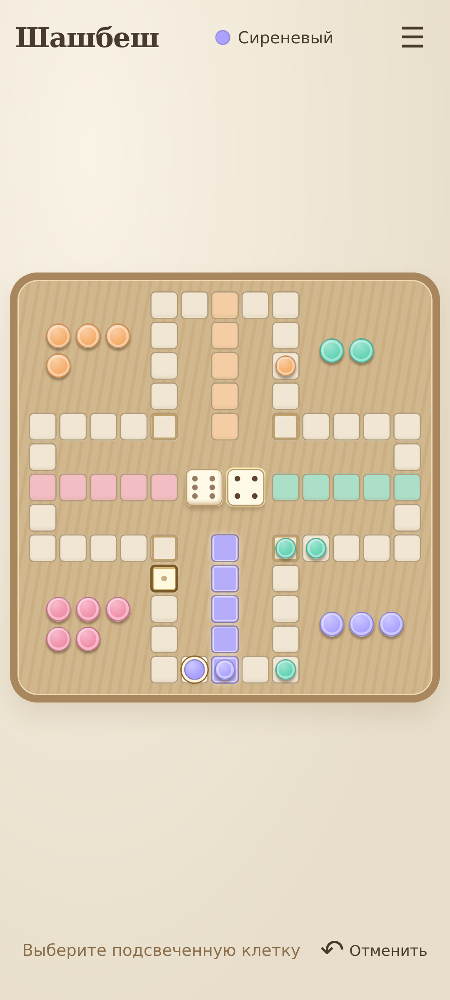
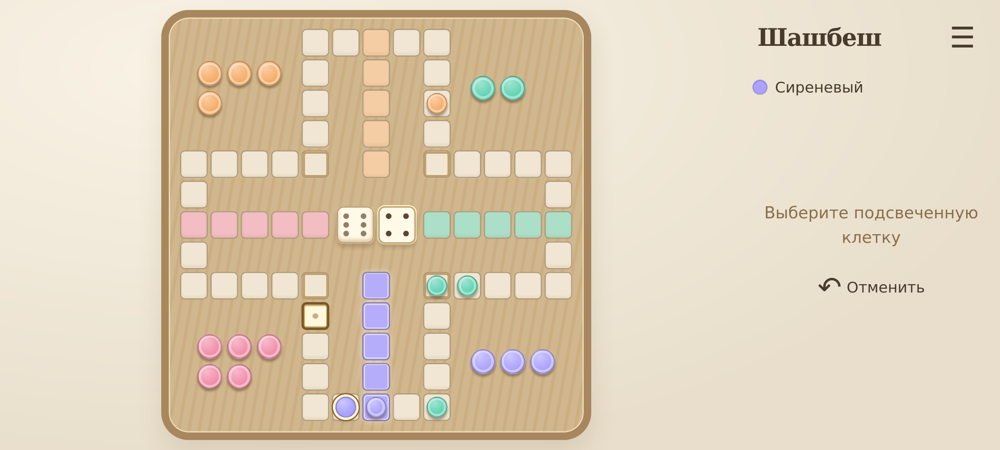

# ShashBesh — v0.3.1-alpha

[Русский](#русский) · [English](#english)

 

Скриншоты браузерного профиля / Browser-profile screenshots.

## Русский

**Шашбеш** — локальная стратегическая настольная игра для 2–4 участников: пять фишек у каждого, два кубика, внешний маршрут на 48 клеток и четыре домашних маршрута. Android и веб-интерфейс показывают физическое поле, цветные фишки и кубики в центре. Обычный соперник-компьютер использует Tactical.

### Что доступно

| Возможность | Состояние alpha |
|---|---|
| Движок, геометрия CSV и проверка допустимых ходов | Реализовано и покрыто тестами |
| Веб-версия, игра 2–4 человек на одном устройстве | Реализовано |
| Android приложение, автономная игра | Реализовано; APK собирается, физическая приёмка ещё требуется |
| Tactical, Random, Greedy | Реализовано |
| ShashBesh AI v0.1 | Экспериментальная обученная локальная сеть |
| История, отмена, сохранения, экспорт и replay | Реализовано |
| LAN / Wi-Fi multiplayer | В разработке: программные тесты есть, реальная сеть/NSD ещё не приняты |
| AI Evolution Lab, турниры между нейросетями | В разработке |

AI v0.1 **не показала превосходство над Tactical**: 19/48 побед в сохранённом контрольном турнире против него. Полные результаты и ограничения: [AI report](docs/AI_TRAINING_REPORT.md). Правила не меняются для удобства интерфейса или ИИ.

### Быстрый запуск

Нужны Node.js 20.19+ и npm.

```bash
npm ci
npm run dev
```

Откройте http://127.0.0.1:5173. Выберите место игры, соперника и число участников. Нажимайте кубики, затем фишку и подсвеченную клетку. После разыгрывания всех доступных действий касание кубиков завершает бросок; следующее касание выполняет новый бросок. До передачи очереди можно отменить своё действие. История, архив и технический режим доступны через меню.

APK публикуется отдельно в [GitHub Releases](https://github.com/mistermetes-cloud/ShashBesh/releases). В текущей подготовке релиза используется debug-подпись; установка на Huawei/Realme ещё требует проверки. [Установка и сборка](docs/INSTALLATION.md), [изменения](CHANGELOG.md), [план развития](docs/ROADMAP.md).

```bash
npm test
npm run test:neural-python  # требуется NumPy из packages/neural/python/requirements.txt
npm run build
npm run android:alpha     # требуется JDK 21 и Android SDK 35
```

[Правила v1](docs/RULES_V1.md) и [CSV](data/igra_64_koordinaty.csv) — источники правил и геометрии. [Открытые трактовки](docs/OPEN_RULE_QUESTIONS.md) явно отделены от согласованных правил. Журнал имеет SHA256 связь событий; это локальная проверяемая цепочка, не блокчейн. Без seed кубики используют Web Crypto; drand не интегрирован.

Обученные веса входят в исходники. Датасеты, экспериментальные журналы, SDK/JDK, кэши и APK исключены из Git; сохранены в рабочей папке разработчика. [Техническое руководство](docs/DEVELOPER_GUIDE.md), [мобильный отчёт](docs/MOBILE_UI_REPORT.md).

Лицензия проекта будет согласована отдельно; лицензия для этого релиза не выбрана.

## English

**ShashBesh** is a local strategy board game for 2–4 players, with five pieces per player, two dice, a 48-cell outer track and four home routes. Its web and Android interfaces focus on the board, pieces and central dice. Tactical is the default computer opponent.

The engine, web interface, pass-and-play, Tactical/Random/Greedy, history, undo, saves and replay are implemented. Android APK builds are verified; physical-device acceptance remains pending. The trained AI v0.1 is experimental and has not demonstrated superiority over Tactical. LAN/Wi-Fi, AI Evolution Lab and neural-network tournaments are **in development**, rather than accepted release features.

Install Node.js 20.19+ and npm, then run:

```bash
npm ci
npm run dev
```

Open http://127.0.0.1:5173. Choose the play location, opponents and player count. Tap the dice, select a piece and a highlighted destination. Once legal actions are exhausted, tapping the dice finishes the roll; another tap rolls again. Human undo is limited to the current unfinished turn. History, exports and the technical interface are available from the menu.

Android APKs are distributed separately through [GitHub Releases](https://github.com/mistermetes-cloud/ShashBesh/releases). This alpha uses a debug signature. See [installation](docs/INSTALLATION.md), [changelog](CHANGELOG.md) and [roadmap](docs/ROADMAP.md).

Rules and engine behavior are unchanged. The approved [rules](docs/RULES_V1.md) and [CSV geometry](data/igra_64_koordinaty.csv) are authoritative. Unresolved rule interpretations are documented. The event log is a local SHA256 chain, not a blockchain. Dice use Web Crypto unless an explicit reproducible seed is selected; drand is not integrated.

Model weights are included. Raw training datasets, experiment logs, credentials, build caches and APKs are excluded from Git. The owner has selected GPL-3.0-only for owner-controlled original materials, but adoption remains pending model-scope and third-party distribution checks. No project LICENSE has been added. See the [licensing action plan](docs/LICENSING_ACTION_PLAN.md) and [third-party notices](docs/THIRD_PARTY_NOTICES.md); third-party components retain their original licenses.
