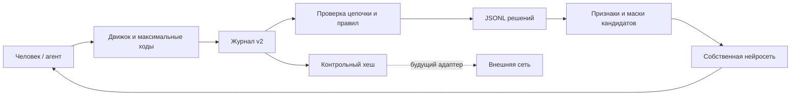

# Архитектура и контракты

## Разделение ответственности
- `engine`: чистые функции `legalActions(state)`, `applyAction(state, action)`, `legalSequencesForRoll(state, dice)`, `finishRoll(state)`, `winner(state)`; никакой зависимости от React, сети, AI, часов.
- `rng`: интерфейс источника случайности, seeded генератор для воспроизведения и криптографически надёжный источник для реальных партий. Результаты бросков фиксируются; seed сам по себе не доказывает честность при выборе организатором.
- `agents`: принимают только публичное состояние и допустимые последовательности, возвращают выбранную последовательность; не могут менять поле или бросок.
- `tournament`: CLI массовых симуляций, статистика побед, средняя длина партии, частота сбитий, угловых прыжков, использованных очков; seed и версии правил обязательны.
- `web`: визуализация поля из CSV, интерфейс ходов, история, повторы, режимы human-human / human-AI / AI-AI; предпочтительна доступность и работа без внешнего API.

## Модель данных
`GameState`: `gameId`, `rulesVersion`, `rulePolicy`, `players` (2..4), `turnOrder` (clockwise), `activePlayer`, `phase` (`initial_roll`, `await_roll`, `resolving_roll`, `game_over`), `currentRoll`, `pieces`, `eventLog`, `winner`, `rngState`/`seedMetadata`.
`PieceState`: `id`, `owner`, `status` (`reserve`, `track`, `home`, `finished`), `position`, `outerSteps`, `homeIndex`, `finishedSlot`.
`Roll`: `id`, `dice:[d1,d2]`, `remainingActions`, `extraRoll`, `rollSequenceNumber`.
`Action`: `pieceId`, `kind` (`deploy`, `move`, `corner_jump`), `value`, `from`, `to`, `path`, `captureIds`.

## Детерминированная валидация
Генератор легальных **полных последовательностей** броска должен:
1. Рассматривать возможные порядки и назначения действий фишкам.
2. Проверять свои фишки на всех промежуточных клетках, включая переход внешнего маршрута в дом.
3. Для действия 1 при доступном угловом прыжке допускать только угловые прыжки.
4. Выбирать последовательности с максимальной суммой номиналов использованных действий.
5. Отдавать агенту только такие максимальные последовательности (или допустимые префиксы, продолжаемые до максимума), исключая обход через UI.
6. Предотвращать циклическое дерево перебора: максимум 4 действия на один бросок; дополнительные броски — отдельные события.
7. Учитывать захват и освобождение клеток при проверке последующих действий того же броска.

## События и проверяемость
Append-only JSONL или эквивалент. `seq`, `gameId`, `rollId`, `actor`, `type`, `payload`, `prevHash`, `hash`; хеш SHA-256 от канонического представления события и `prevHash` (одинаковая сериализация на всех платформах). Логировать жребий, бросок, действие, захват, фиксацию фишки, завершение броска, передачу очереди, победу. Replay строит состояние **только из событий** и проверяет все хеши и инварианты. Для аудита сохранять версию правил и политику спорных случаев. Хеш-цепочка обнаруживает изменения, но без внешней публикации контрольного хеша не защищает от полной подмены журнала.

## Интерфейс
Поле 13×13, 4 цвета, 5 фишек каждого, подсветка активного игрока, выпавших значений и легальных действий, пояснение невозможных ходов, переключатель скорости AI-vs-AI, пауза/продолжение, журнал, экспорт/импорт replay, мобильная адаптация.

## Расширение данных и аудита

Контракт журнала v2, совместимость v1 и внешние checkpoint: [EVENT_CHAIN.md](EVENT_CHAIN.md).
Новый пакет `packages/training`: проверенный replay → решения/снимки → JSONL → признаки собственной нейросети; четыре режима, пропуски и финальные метки описаны в [TRAINING_DATA.md](TRAINING_DATA.md).

Внешний clock передаётся в Engine как контекст аудита; правила и генератор допустимых действий не зависят от времени. Replay вводит сохранённые timestamps и проверяет производные события. Идентификатор решения фиксируется в момент действия/вынужденного пропуска, а не выводится из текущей настройки UI задним числом. Результат партии добавляется ко всем решениям при экспорте проверенного журнала. Смена автора между ходами сохраняется.

## Обучаемая модель v0.1

`packages/neural`: проверка корпуса, compact-features, NumPy fit, переносимый JSON-checkpoint и TypeScript ActionScorer. `encodePublic` общий для dataset/inference и не принимает outcome/after как входные поля. Первоначальная сеть 269→24 tanh→1 обучается behavior cloning Tactical, выбирает только по fresh legal mask. `resolveAgentRoll` выполняет neural-политику по одному действию; базовые агенты сохраняют выбор полной последовательности.

Архитектура замены: ActionScorer → scores(state, legalActions, geometry), immutable checkpoint/featureVersion/rules/geometry hash. Другая сеть меняет adapter/loader, не GameState transitions. `arena.compareModels` поддерживает candidate/champion на swapped-seat paired seeds. `lifecycle` задаёт gate и rollback, registry архивирует snapshots по checksum, active-model служит локальному inference. Self-play exporter фиксирует probability/parent hash/terminal return обеих сторон; signed-return gradient подготовлен, длительного actor-critic/PPO training loop пока нет.

Контрольный отчёт: [AI_TRAINING_REPORT.md](AI_TRAINING_REPORT.md).
